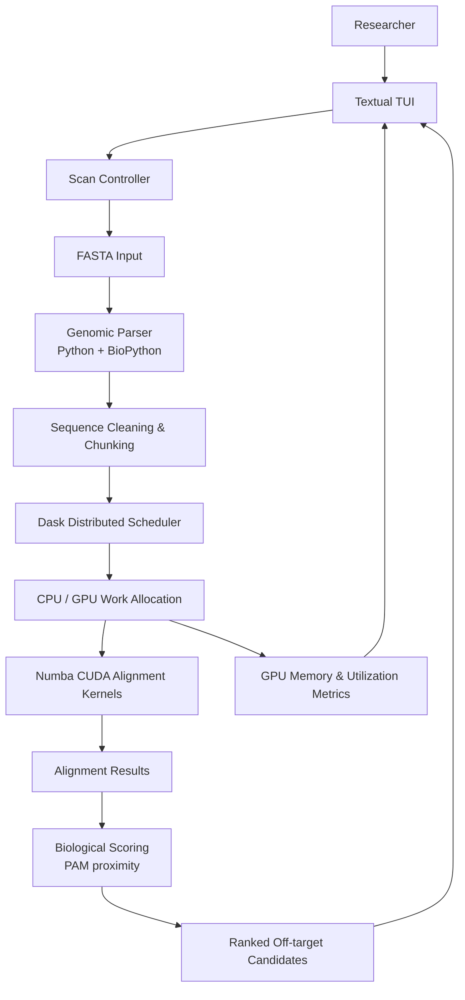

# GeneWeaver — System Architecture

**Project:** GPU-Accelerated CRISPR Alignment Engine  
**Domain:** Bioinformatics & High-Performance Computing (HPC)

## 1. Purpose

GeneWeaver processes large FASTA genomic sequence files and searches for potential CRISPR off-target mutations. It uses BioPython for parsing, Numba CUDA for GPU-accelerated alignment, Dask for distributing genomic chunks when multiple GPUs or machines are available, and Textual for a terminal dashboard.

## 2. High-Level Architecture



## 3. Main Components

| Component | Technology | Responsibility |
|---|---|---|
| Input layer | FASTA files | Accepts genomic sequence data for scanning. |
| Genomic parser | Python, BioPython | Reads FASTA records, cleans sequence data, and prepares it for processing. |
| Chunking layer | Python arrays | Splits large sequences into manageable genomic chunks. |
| Distributed scheduler | Dask | Distributes chunks across available GPUs or machines, where available. |
| Alignment engine | Numba CUDA | JIT-compiles custom CUDA kernels to perform many base-pair comparisons in parallel on NVIDIA GPUs. |
| Scoring layer | Biological scoring logic | Ranks detected off-target candidates using criteria such as PAM-sequence proximity. |
| Dashboard | Textual | Displays scan progress, GPU memory consumption, core utilization, alignment progress, and mismatches. |

## 4. End-to-End Data Flow

1. The researcher starts a scan from the terminal dashboard and supplies a FASTA file.
2. The parser reads the FASTA records using BioPython and cleans/prepares the genomic sequences.
3. The prepared sequence is divided into manageable chunks.
4. Dask schedules chunks across available GPU workers or machines, if configured.
5. The alignment engine transfers required data from host memory (CPU RAM) to device memory (GPU VRAM).
6. Numba CUDA kernels execute parallel sequence comparisons on NVIDIA GPU hardware.
7. Alignment results are collected and passed to the biological scoring stage.
8. Candidate off-target mutations are ranked, including by PAM-sequence proximity.
9. The Textual dashboard reports progress, GPU resource usage, and the detected mismatches.

## 5. Important Engineering Considerations

- **Memory management:** Process large genomic inputs in chunks and manage CPU-to-GPU transfers carefully to avoid `CUDA_OUT_OF_MEMORY` errors.
- **GPU availability:** CUDA execution requires compatible NVIDIA GPU hardware and a working CUDA environment. The project brief does not define a CPU fallback design.
- **Distributed execution:** Dask is intended to coordinate work across multiple GPUs or machines when available.
- **Performance validation:** Establish a pure-Python CPU baseline, then benchmark the CUDA implementation against it. The project brief sets a target of at least 100× speedup for alignment calculations.
- **Biological validity:** Scoring and candidate interpretation should follow the project's chosen biological criteria; the brief gives PAM-sequence proximity as an example.
- **Observability:** The dashboard should expose alignment progress, GPU memory use, and core utilization.

## 6. Suggested Repository Layout

This is a practical proposed layout based on the modules in the project brief; exact filenames and interfaces are not prescribed by the brief.

```text
geneweaver/
├── README.md
├── requirements.txt
├── config/
│   └── settings.py
├── data/
│   └── sample.fasta
├── src/
│   └── geneweaver/
│       ├── __init__.py
│       ├── parser.py
│       ├── preprocessing.py
│       ├── chunking.py
│       ├── scheduler.py
│       ├── alignment/
│       │   ├── __init__.py
│       │   └── cuda_kernels.py
│       ├── scoring.py
│       ├── pipeline.py
│       └── dashboard/
│           ├── __init__.py
│           └── app.py
└── tests/
    ├── test_parser.py
    ├── test_chunking.py
    ├── test_scoring.py
    └── test_alignment.py
```

## 7. Development Milestones from the Project Brief

| Stage | Main deliverable |
|---|---|
| Week 1 | Implement a pure-Python CPU alignment baseline; parse a mock human genome FASTA file with BioPython and chunk it into manageable arrays. |
| Week 2 | Rewrite the alignment algorithm with Numba `@cuda.jit`; handle CPU RAM ↔ GPU VRAM transfers; scaffold the Textual interface and progress bars. |
| Mid-project review | Benchmark GPU against CPU, targeting at least 100× speedup; verify that large datasets do not cause CUDA out-of-memory errors. |
| Week 3 | Integrate Dask for distributed workload scheduling; implement biological scoring such as PAM-sequence proximity. |
| Week 4 | Optimize with CUDA shared memory; polish the TUI and highlight DNA mismatches visually. |

## 8. Scope Notes

This architecture reflects the GeneWeaver description in the supplied *Infotact Solutions Project Document – Advanced Python Engineering (Vol. II)*, pages 1–2. The repository layout and the explicit “scan controller”, “preprocessing”, and “pipeline” boundaries above are proposed organization choices to make implementation clearer; they are not specified as exact modules in the source document.

**Core technology stack:** Python, BioPython, Numba CUDA, Dask, and Textual. The project summary on page 6 also lists CuPy as a technology focus, but the detailed GeneWeaver module descriptions on page 1 specifically describe Numba CUDA, BioPython, Dask, and Textual. CuPy's precise role is not defined in the brief.
